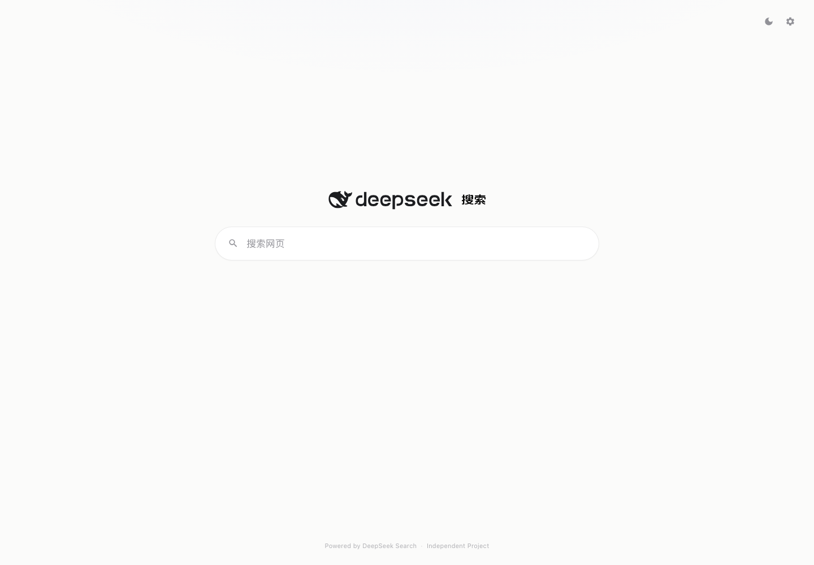
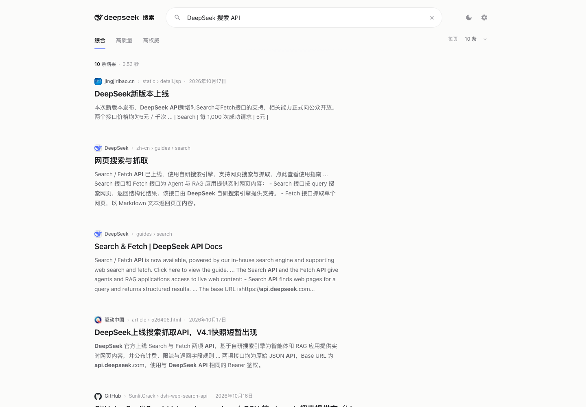
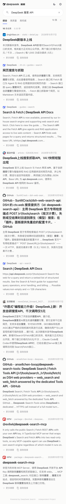
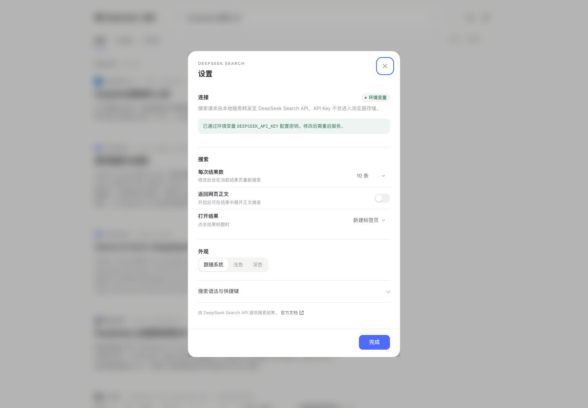

# DeepSeek 搜索 · 克制而精致的搜索界面

基于 [DeepSeek 最新开放的 Search API](https://api-docs.deepseek.com/zh-cn/guides/search) 的本地搜索演示。界面以留白、排版与细节为核心：保留 Google 式的信息层级与搜索直觉，同时用更克制的配色、更安静的状态表达和更精致的做工，做成一个像正式产品而不是 API Demo 的搜索页。

- 后端：零依赖 Node.js 服务，托管页面并把 `/api/search` 代理到 `POST https://api.deepseek.com/v1/tools/search`
- 前端：原生 HTML / CSS / JavaScript，无构建步骤、无第三方依赖
- 设计：Google 式的结果信息层级 + Apple / Linear 式的留白、圆角与细节；DeepSeek 品牌黑白字标，品牌蓝只用于焦点、选中和必要交互
- 隐私：API Key 只保存在本地服务内存或环境变量中，不写入浏览器存储

> 以下截图为 **2026-10-17 使用真实 DeepSeek API Key 的实际返回结果**（查询 `DeepSeek`）。




<details>
<summary>移动端结果页预览（390 × 844）</summary>



</details>

<details>
<summary>设置面板（连接、搜索偏好与外观）</summary>



</details>

## 快速开始

要求：**Node.js ≥ 20.12**（不需要 `npm install`，项目没有依赖）。

### 方式一：`./run.sh`（推荐）

```bash
cd Search
./run.sh
```

脚本会自动：

- 优先使用 `DEEPSEEK_API_KEY` 环境变量；
- 否则读取 `~/keys`（可用 `KEY_FILE` 指定其它文件）；
- 从 8787 开始自动寻找空闲端口，并在终端打印实际地址；
- 密钥不会回显，也不会写入项目。

```bash
# 指定起始端口（被占用会自动顺延）
PORT=8899 ./run.sh

# 指定其它 Key 文件
KEY_FILE=/path/to/key ./run.sh
```

### 方式二：手动启动

```bash
# 通过环境变量提供 API Key
DEEPSEEK_API_KEY=sk-你的密钥 npm start

# 或复制 .env.example 为 .env 并填写，然后：
npm start

# 或先启动，再在页面右上角「设置」中粘贴 Key
PORT=8899 npm start
```

默认端口是 `8787`；如果被占用，按终端提示或手动指定 `PORT`。浏览器打开脚本/日志里打印的 `http://127.0.0.1:<端口>`。

也可以先 `npm start`，再打开页面右上角 **设置 → API 连接**，粘贴 API Key。这种方式下密钥只保存在本地 Node 进程内存里，**服务重启后失效，不落盘**。Key 可以在 [DeepSeek 开放平台](https://platform.deepseek.com) 创建。

> 不要把带密钥的服务暴露到公网。该服务只监听 `127.0.0.1`，并做了 Host 校验以降低 DNS rebinding 风险。若要部署到服务器，请在反向代理层自行加鉴权。

## 功能

- **极简首页**：缩小 DeepSeek 字标，680 × 60 的胶囊形搜索框成为唯一视觉中心，略微偏上，留白充分
- **克制的顶栏**：首页只保留主题切换与设置入口；结果页保留品牌、搜索与轻量筛选
- **精致搜索框**：胶囊形、弱边框、柔和层次、细腻的聚焦环；支持 `/`、`⌘/Ctrl K`、Enter 与建议键盘操作
- **安静的结果页**：传统左对齐列表，不使用厚重卡片；标题、来源、日期、摘要与留白建立层级，不展示排序分徽标
- **收纳技术细节**：API 连接状态、搜索语法、快捷键和文档入口都收进设置面板；正常连接不显示状态，异常时才轻提示
- **克制的页脚**：无分割线、无重复链接，只保留 `Powered by DeepSeek Search · Independent Project`
- **搜索能力**：全部 / 高质量 / 高权威筛选、每次 10/20/30/50 条、长摘要、网页正文摘录、结果打开方式（默认新建标签页）
- **错误处理**：401 / 402 / 403 / 408 / 413 / 429 / 5xx 都有对应中文说明与重试/配置入口；无网络时给出启动指引
- **主题与细节**：跟随系统 / 浅色 / 深色，可持久化；轻盈动画并响应 `prefers-reduced-motion`
- **无障碍**：语义化 landmark、combobox/listbox ARIA、原生 `<dialog>`、可见焦点环、图片失败降级
- **零伪造分页**：Search API 单次最多返回 50 条且没有分页参数，所以结果页只展示本次真实返回，不伪造页码

## 搜索语法

语法会原样传给 DeepSeek Search API：

| 语法 | 示例 | 说明 |
| --- | --- | --- |
| `site:` | `DeepSeek site:github.com` | 限定站点 |
| `-site:` | `DeepSeek -site:example.com` | 排除站点 |
| `"..."` | `DeepSeek "搜索 API"` | 精确短语 |
| `-` | `DeepSeek -广告` | 排除关键词 |
| `lang:` | `DeepSeek lang:zh,en` | 限定语言 |
| `after:` / `before:` | `DeepSeek after:2025` | 发布时间范围 |

## 项目结构

```
Search/
├── index.html            # 页面结构、SVG 图标、设置弹窗
├── assets/
│   ├── styles.css        # 克制视觉系统、深色主题、响应式
│   ├── app.js            # 视图路由、搜索、建议、设置、错误处理
│   ├── theme-init.js     # 首屏防闪烁主题初始化
│   ├── favicon.svg       # 黑白鲸鱼 favicon
│   └── search-wordmark.png # 透明背景的「搜索」字标原图（已裁切留白）
├── server.mjs            # 本地静态服务 + Search API 代理（零依赖）
├── run.sh                # 一键启动：自动读 Key、自动找空闲端口
├── test/
│   ├── mock-upstream.mjs # 本地模拟上游，方便无 Key 联调 UI
│   ├── server-check.mjs  # API 参数校验、错误透传与安全回归
│   └── ui-check.mjs      # Chrome DevTools Protocol 冒烟测试与截图
├── .env.example
└── package.json
```

## 配置

| 环境变量 | 默认值 | 说明 |
| --- | --- | --- |
| `DEEPSEEK_API_KEY` | 空 | DeepSeek API Key；留空时可在网页设置中填写 |
| `PORT` | `8787` | 本地服务端口 |
| `HOST` | `127.0.0.1` | 监听地址 |
| `DEEPSEEK_BASE_URL` | `https://api.deepseek.com` | 上游地址，仅用于本地 mock 联调；不建议在正式使用时改动 |
| `KEY_FILE` | `~/keys` | 仅 `./run.sh` 使用：自动读取的 Key 文件路径 |

服务端行为：

- `GET /api/status`：返回是否已配置 Key（不返回 Key 本身）与上游 host
- `POST /api/key`：把 Key 写入服务进程内存（若已有环境变量 Key，则返回 `409`）
- `DELETE /api/key`：清除内存中的 Key
- `POST /api/search`：校验 `query`（1–128 个 Unicode 字符）、`count`（1–50）、`need_content` 后转发到上游
- 仅允许本机 Host 访问 API；请求体上限 64 KB；连续请求之间至少间隔 220 ms，减少触发账号级 5 QPS 限制
- 静态资源白名单只暴露 `index.html` 与 `assets/`，不会把 `.env`、`server.mjs` 当静态文件送出

## 本地 UI 联调（无需真实 Key）

```bash
# 终端 1：模拟 DeepSeek Search API（端口 8940）
npm run mock

# 终端 2：把本地服务指向上游 mock
DEEPSEEK_BASE_URL=http://127.0.0.1:8940 DEEPSEEK_API_KEY=test PORT=8899 npm start
```

mock 支持特殊查询：`__empty`（空结果）、`__error401`、`__error429`、`__slow`（延迟 2.5 秒观察骨架屏）。

自动化回归测试：

```bash
# 1) 语法检查
npm run check

# 2) API / 安全回归（需要先启动 mock + 代理；见上一节）
BASE_URL=http://127.0.0.1:8899 node test/server-check.mjs

# 3) 浏览器 UI 冒烟（需要本机 Chrome；截图输出到 /tmp/ds-ui-check/）
BASE_URL=http://127.0.0.1:8899 node test/ui-check.mjs
```

`test/server-check.mjs` 覆盖：`/api/status` 不泄露 Key、搜索正常链路与参数校验、64 KB 请求体边界、上游 401/429/空结果透传、405 语义、`/api/key` 的 Content-Type/长度/保存/清除/环境变量 409、静态目录穿越、Host/Origin 防护、`no-cache` 与 MIME 类型。

`test/ui-check.mjs` 覆盖：极简首页布局与 680 × 60 胶囊搜索框、建议下拉、Enter 搜索、历史前进/后退、筛选、展开摘要、结果条数、设置里正文开关与结果打开方式的实际切换、搜索语法收纳、`need_content` 正文展示、`target=_blank`、深色主题、空结果、401 错误、XSS 字段转义、超长无空格字段的横向溢出、移动端布局与「未配置 Key → 保存 Key → 自动重试」流程。

当前回归结果：`server-check` **29/29**；`ui-check` **39/39**（已配置 Key）/ **42/42**（无 Key → 保存 Key → 自动重试完整流程）。

安全行为还包括：

- API 路由校验 `Host` 必须为本机，并校验 `Origin` 与 `Host` 一致（纵深防御 CSRF）
- 静态资源先规范化路径再走白名单，`..`/编码穿越会 404；`.env`、`server.mjs` 等文件不会被托管
- 页面 CSP 为 `default-src 'self'`、`script-src 'self'`、`style-src 'self'`、`object-src 'none'`
- 结果字段全部做 HTML 转义，只允许 `http:` / `https:` URL；`javascript:`、`data:` 链接和图标会被拒绝
- API Key 只存在于服务进程内存或环境变量，不写入 localStorage/sessionStorage，也不会出现在日志和 API 响应中

## 关于 Search API

- Endpoint：`POST https://api.deepseek.com/v1/tools/search`
- 鉴权：`Authorization: Bearer <DEEPSEEK_API_KEY>`
- 计费：按成功请求计费，¥5 / 1,000 次（以官方文档为准）
- 限速：账号级 5 QPS，超限返回 `429`
- 单次最多返回 50 条，无分页参数
- 官方文档：[网页搜索与抓取](https://api-docs.deepseek.com/zh-cn/guides/search)

## 已知限制

- 已使用真实 DeepSeek API Key 完成端到端验证：真实搜索返回 10 条结果，耗时约 0.3–0.8 秒，`need_content=true` 可返回正文；计费明细与长时间限流未做压力测试。
- Search API 没有分页参数，结果页只展示本次请求返回的 1～50 条。
- 浏览器自动化只在 Chrome 上运行；Safari/Firefox 仅做了代码层面的兼容性考虑。
- 这是本地演示项目，不适合直接暴露到公网；若需部署请在反向代理层增加鉴权与 TLS。

## 说明

- 本项目是非官方演示，与 Google、DeepSeek 均无隶属关系。
- 界面在信息层级与搜索直觉上参考 Google，在留白、圆角与细节上参考 Apple / Linear 等产品；界面图标路径来自 Google Material Icons（Apache 2.0）。
- DeepSeek 鲸鱼图形与 `deepseek` 字标取自 DeepSeek 官方站点，商标及相关权利归 DeepSeek 所有，仅用于本演示。
- 「搜索」二字使用你提供的透明背景字标原图（已裁切边距），浅色主题显示黑色、深色主题反白。
- 结果内容与排序均由 DeepSeek Search API 返回，本项目只做展示。
